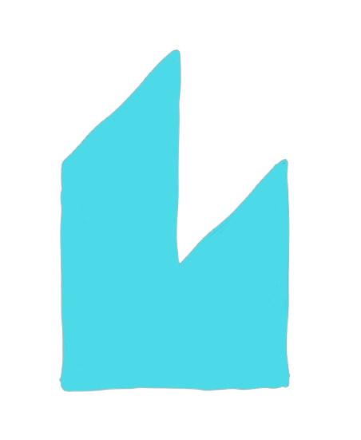

<p align="center">
  
</p>

<h1 align="center">Dim Framework</h1>

<p align="center">
  <strong>A React-inspired functional web components framework</strong>
</p>

<p align="center">
  Build modern web applications with familiar React-like syntax, powered by native Web Components
</p>

<div align="center">
  
[**Live Demo & Documentation**](https://dim.positive-intentions.com) | [**Getting Started**](https://dim.positive-intentions.com/?path=/docs/getting-started--docs) | [**Demo**](https://dim.positive-intentions.com/?path=/story/getting-started--live-demo) | [**API Reference**](https://dim.positive-intentions.com/?path=/docs/api-reference--docs)

</div>

<div align="center">
  
 
 
 


 
[](https://github.com/positive-intentions/dim/actions/workflows/pages/pages-build-deployment)

</div>

---

## Overview

Dim is a lightweight framework that brings React's component model and hooks to native Web Components. Write familiar functional components with hooks while leveraging the power of web standards.

> **Experimental**: This framework is in early development and is not production-ready. It's provided for educational and experimental purposes.

> **Upgrading?** See [MIGRATION.md](MIGRATION.md) for breaking API changes (`useStore`, object attributes, `useFS`, crypto format). See [CHANGELOG.md](CHANGELOG.md) for release notes (created on the first publish).

## Install

```bash
npm install @positive-intentions/dim
```

## Features

- **React-like DX** - Familiar hooks API (`useState`, `useEffect`, `useMemo`, etc.)
- **Web Standards** - Built on native Web Components and Shadow DOM
- **Scoped Styling** - CSS-in-JS with automatic style isolation
- **Zero runtime deps** - Own template renderer; pure JS for the core (no React on the main entry)
- **Lightweight** - Parts-based updates preserve focus, selection, and child state
- **State Persistence** - Built-in global state management with `useStore`

## Getting Started

### Quick Example

```javascript
import { html, css, define, useState, useStyle } from "@positive-intentions/dim";

// Create a component
const Counter = (props, { useState, html, css, useStyle }) => {
  const [count, setCount] = useState(0);

  useStyle(css`
    .counter {
      padding: 2rem;
      text-align: center;
    }

    button {
      background: #029cfd;
      color: white;
      border: none;
      padding: 0.5rem 1rem;
      border-radius: 4px;
      cursor: pointer;
    }
  `);

  return html`
    <div class="counter">
      <h2>Count: ${count}</h2>
      <button @click="${() => setCount(count + 1)}">Increment</button>
    </div>
  `;
};

// Register as custom element
define({ tag: "my-counter", component: Counter });

// Use it
// <my-counter></my-counter>
```

### React interop

The main package entry does **not** import React, so it works with native ES modules in the browser. For the React hook that shares Dim's encrypted store:

```javascript
import { useDimStore } from "@positive-intentions/dim/react";
```

`react` is an optional peer dependency required only when you use this subpath.

## Core Concepts

### Hooks

Dim provides React-like hooks for managing component logic:

#### `useState` - Local State Management

```javascript
const [value, setValue] = useState(initialValue);
```

#### `useEffect` - Side Effects

```javascript
useEffect(() => {
  // Effect logic
  return () => {
    // Cleanup
  };
}, [dependencies]);
```

#### `useStyle` - Scoped CSS

```javascript
useStyle(css`
  .my-class {
    color: blue;
  }
`);
```

#### `useScope` - Component Composition

```javascript
// Hyphenated tag keys
useScope({
  "child-component": ChildComponent,
});

// Or tagged functions after define() stamped `.tag`
define({ tag: "child-component", component: ChildComponent });
useScope({ ChildComponent });
```

#### `useMemo` - Memoized Values

```javascript
const expensive = useMemo(() => {
  return computeExpensive(value);
}, [value]);
```

#### `useRef` - DOM References

```javascript
const inputRef = useRef();
// Access via inputRef.current
```

#### `useStore` - Global State

```javascript
const {
  user: [user, setUser],
} = useStore({
  user: { name: "John" },
});
```

## Examples

### Todo List

```javascript
const TodoList = (props, { useState, html, css, useStyle }) => {
  const [todos, setTodos] = useState([]);
  const [input, setInput] = useState("");

  const addTodo = () => {
    if (input.trim()) {
      setTodos([
        ...todos,
        {
          id: Date.now(),
          text: input,
          done: false,
        },
      ]);
      setInput("");
    }
  };

  return html`
    <div>
      <input
        .value="${input}"
        @input="${(e) => setInput(e.target.value)}"
        @keydown="${(e) => e.key === "Enter" && addTodo()}"
      />
      <button @click="${addTodo}">Add</button>

      <ul>
        ${todos.map(
          (todo) => html`
            <li class="${todo.done ? "done" : ""}">
              <input
                type="checkbox"
                .checked="${todo.done}"
                @change="${() => toggleTodo(todo.id)}"
              />
              ${todo.text}
            </li>
          `
        )}
      </ul>
    </div>
  `;
};
```

## Documentation

The framework includes comprehensive documentation through Storybook:

### Main Sections

1. **Getting Started** - Introduction and quick start guide
2. **Core Concepts** - Deep dive into hooks and component architecture
3. **Tutorial** - Step-by-step guide to building applications
4. **Examples** - Real-world patterns and implementations
5. **API Reference** - Detailed documentation for each hook

### Hook Categories

- **State Management**: `useState`, `useStore`
- **Effects & Lifecycle**: `useEffect`, `useRef`
- **Performance**: `useMemo`
- **Styling**: `useStyle`
- **Composition**: `useScope`

Visit the [live documentation](https://dim.positive-intentions.com) for interactive examples and detailed guides.

## Development

### Setup

```bash
# Clone the repository
git clone https://github.com/positive-intentions/dim.git

# Install dependencies
npm install

# Start Storybook dev server
npm run storybook

# Build the publishable library
npm run build:lib

# Build Storybook / federation docs site
npm run build
```

### Project Structure

```
dim/
├── src/
│   ├── core/
│   │   ├── index.ts        # Public API (published as @positive-intentions/dim)
│   │   ├── dim.ts          # Compatibility shim (re-exports index)
│   │   ├── renderer/       # html/css tagged templates, parts, render()
│   │   ├── element/        # DimElement, define(), props helpers
│   │   ├── hooks/          # useState, useEffect, useMemo, useRef, useStyle, useScope
│   │   ├── store/          # useStore, crypto/storage/async managers
│   │   ├── transitions/    # view transitions + AutoTransitionHost
│   │   └── fs/             # useFS + File System Access handle persistence
│   └── stories/            # Storybook docs and demo apps
├── public/
└── README.md
```

## Releasing

Releases are manual and Changeset-driven.

1. In a PR that changes the public API or user-facing behavior, run `npx changeset`, choose **patch** / **minor** / **major**, and write a short summary.
2. Merge the PR (with its changeset file) into `staging`.
3. On GitHub: **Actions → Publish → Run workflow** (optionally enable **dry_run** first).
4. The workflow versions the package, updates `CHANGELOG.md`, publishes `@positive-intentions/dim` to npm with provenance, pushes a `vX.Y.Z` tag, and creates a GitHub Release.

**Prerequisites (one-time):** create the `@positive-intentions` org on npm, enable [Trusted Publishing](https://docs.npmjs.com/trusted-publishers) for this repo’s `publish.yml` workflow, and create a GitHub Environment named `npm` (optional protection rules / required reviewers).

## License

This project is licensed under the GNU General Public License v3.0 (GPL-3.0) — see the [LICENSE](LICENSE) file for details. You are free to use, modify, and distribute this software; **distributed derivative works must also be licensed under GPL-3.0**.

## Acknowledgments

- Inspired by React's component model and hooks
- Built on native Web Components with Dim's own template renderer
- Community feedback

---

<p align="center">
  Dim is brought to you by <a href="https://positive-intentions.com">positive-intentions</a>. Built with positivity.
</p>
